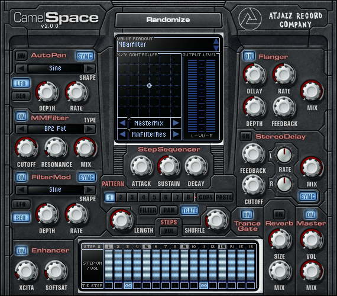

# Camel Space 2 — ARCo. Edition

**Version 2.0.0 · macOS · VST3 effect**

A restoration of CamelSpace for a modern Apple Silicon Mac, keeping its original
sound engine, controls and preset formats. The interface retains the classic
knobs, buttons, bitmap fonts and 570 × 500 layout, with a dark panel, the
transparent Atjazz Record Company logo, and white **2.0.0** and **Randomize** text.



**This repository contains the restoration source and build tools.** It does
not include the original Camel Audio engine, factory banks, control artwork or
manual, and there is no ready-to-install binary download in this repository.
Building requires your own compatible **CamelSpace.vst** and **CS Support
Files.pkg**. The tools recover their contents without running the old installer.

## What has been done

- Added a native ARM64 VST3 front end so the effect can be hosted by a native
  Apple Silicon DAW. Each instance runs the original Intel engine in a separate
  helper process through Rosetta 2.
- Recreated the editor with current drawing code and the original control
  sprites, positions, selector text, XY pad, meters and sequencer geometry.
- Applied the requested Atjazz dark appearance while retaining the original
  control styling. Updated the displayed, bundle and VST3 version to 2.0.0.
- Preserved all 344 original host parameters, tempo and transport handling,
  MIDI input, MIDI Learn, bank state and independent instance recall.
- Added factory preset browsing, original FXP/FXB import and export, a current
  bank menu including blank slots, and all 25 CSP sequencer patterns with
  import and export.
- Recovered the supplied support archive directly, with path/link checks,
  file hashes and an inventory, leaving the original downloads unchanged.
- Added build, recovery, bridge, host, editor, preset/state and audio comparison
  checks, plus an installer that backs up the previous build outside the DAW's
  scanned VST3 folder.

This is a **native interface with an Intel/Rosetta sound engine**. It is not a
recompilation of CamelSpace's DSP for ARM64. The sound engine's instructions are
not patched. It is an independent restoration, not an official Camel Audio
release.

## Requirements and compatibility

| Item | Requirement / current status |
| --- | --- |
| Computer | Apple Silicon Mac; Intel Macs have not been validated |
| macOS | Tested locally on macOS 26.6.2; deployment target 11.0 is a build setting, not a claim that every intervening OS was tested |
| Translation | Rosetta 2 must be installed for the Intel helper and engine |
| Host | A macOS VST3 host; use a stereo audio-effect insert |
| Original files | Compatible CamelSpace 1.50.1.609 / internal version 1.501 VST2 bundle and its matching support package |
| Developer tools | Apple Command Line Tools or Xcode, CMake 3.22+, Ninja, Git and Python 3.11+ |
| Formats | VST3 only; no AU, AAX or Windows build is provided |
| Signing | Local builds are ad hoc signed; no Developer ID signing or notarisation |

The adapter depends on the ABI of the specific original binary tested. Other
CamelSpace versions are unverified. This is an experimental restoration;
[the verification record](docs/VERIFICATION.md) describes its limits.

## Build and install from source

Close your DAW before replacing an installed build. Keep the original plug-in
bundle and support package together in a folder of your choice. Do not run the
obsolete support installer.

1. Clone the repository and fetch the pinned JUCE source:

   ```sh
   git clone https://github.com/vincepeaceuk/Camelspace-2.0.git
   cd Camelspace-2.0
   python3 tools/bootstrap.py
   ```

   JUCE is pinned to **9.0.5**, commit
   `d60b7a78030661574a615b586d9325ba7a7fa7dd`. The bootstrap checks that revision
   and refuses an unexpected existing checkout.

2. Prepare the runtime using **your own files**. Replace these example paths:

   ```sh
   python3 tools/prepare_resources.py \
     --plugin '/path/to/CamelSpace.vst' \
     --package '/path/to/CS Support Files.pkg'
   ```

   The supplied package must be the old directory-style package containing
   `Contents/Archive.pax`. The tool copies and signs a working copy of the engine,
   extracts the support data into `local/`, and builds the preset index. It does
   not execute installer scripts. `local/` is excluded from Git.

3. Build the native front end, Intel helper and checks:

   ```sh
   cmake -S . -B build -G Ninja \
     -DCMAKE_BUILD_TYPE=Release \
     -DCMAKE_OSX_ARCHITECTURES=arm64
   cmake --build build --parallel 4
   ctest --test-dir build --output-on-failure --parallel 1
   ```

   The exact audio comparison may report tiny differences between original
   instances; see **Validation and known limits** below. A failure should be
   investigated rather than treated as a guaranteed sound-engine regression.

4. Install the built VST3:

   ```sh
   python3 tools/install.py \
     --bundle 'build/CamelSpace2_artefacts/Release/VST3/Camel Space 2.vst3'
   ```

   It installs to:

   ```text
   ~/Library/Audio/Plug-Ins/VST3/Camel Space 2.vst3
   ```

   Any previous build is preserved in a dated folder beneath:

   ```text
   ~/Library/Audio/Plug-Ins/Camel Space 2 Backups/
   ```

5. Restart your DAW or rescan VST3 plug-ins. Select **Camel Space 2**, vendor
   **Atjazz Record Company**, on a stereo audio track or bus.

If you already have a locally prepared binary package, extract it and run its
**Install.command** instead of building. That script belongs to the local binary
package; `tools/Install.command` in the source checkout is its packaging template.
The GitHub **Download ZIP** button downloads source, not an installable plug-in.

To uninstall, close the DAW and remove only `Camel Space 2.vst3` from the user
VST3 folder. To restore an earlier build, copy its preserved bundle back there
while the DAW is closed. User-created CSP files are stored separately.

## Using presets and controls

Click the preset name to open the factory browser, load/save an **FXP** preset or
**FXB** bank, clear a preset, or open the recovered original manual. **Current
Bank** shows all 64 slots of an imported/current bank, including blanks and
edited programs. Right-click a knob for **MIDI Learn** and linear/circular drag
options. Route MIDI to the effect in your host when using MIDI Learn or triggers.

The sequencer menu includes the **25 original CSP patterns** and CSP load/save.
New sequencer files default to:

```text
~/Library/Application Support/Camel Space 2/
```

The supplied ten original FXB files contain **640 slots: 540 named and 100
blank**. `-Default.fxb` duplicates `Rhythmic1.fxb` byte for byte, so the factory
browser omits the duplicate category and exposes **476 named entries**. Two
different programs share the name `Wobble`; both are retained. No preset values
are converted. See [the recovery inventory explanation](docs/PRESET-RECOVERY.md).

Old **VST2** instances in saved projects do not automatically become this VST3.
Replace those instances manually and load their FXP/FXB files. Existing
**Camel Space 2 VST3** identifiers and state formats were kept for the 2.0.0 skin
update. A full Cubase project save/reopen session is still an acceptance gap.

## Validation and known limits

The original restoration was checked locally on **19 November 2026** with native
VST3 hosting, editor gestures/rendering, all factory entries, independent instance
state recall, MIDI Learn, CSP files, FXP/FXB round trips, recovery and parser bounds.
**pluginval 1.0.4, strictness 5**, including GUI checks, passed at 44.1, 48, 96 and
192 kHz and 32, 256 and 1024 frame blocks. These are recorded local results,
not a claim of compatibility with every host or Mac.

A final diagnostic compared **6,480 cases / 45,342,720 samples** with the original
engine and matched bit for bit. An earlier aligned run had 494 non-exact cases,
with a maximum difference of about **0.00000252**. Tiny differences were also
reproduced between two direct original instances without the bridge. The engine
uses clock-seeded random LFOs; additional hidden state remains unidentified.
Input-copy hardening of the comparison is not a proven DSP fix, and repeatable
bit-identical output is not guaranteed. The exact comparison keeps its strict
checks. See [VERIFICATION.md](docs/VERIFICATION.md) for both results.

Other limits:

- Full historical-editor pixel parity cannot be certified: the old editor's
  tested drawing paths were blank on this Mac. The native editor uses recovered
  original artwork and geometry; [the editor investigation](docs/EDITOR-INVESTIGATION.md)
  records what was observed.
- A full Cubase music session and Cubase project save/reopen, other macOS
  versions, Intel Macs and long-duration physical MIDI testing remain unverified.
- An unavailable, stalled or busy helper can temporarily return dry input.
  The bridge is not a hard real-time guarantee.
- AU support has not been implemented. The existing VST3 code cannot simply be
  renamed to `.component`.

The standalone source was rebuilt and checked on **24 November 2026**. See
[the public source import record](docs/PUBLIC-SOURCE-IMPORT.md) for the checks
performed for this repository layout.

## Tests without original files

The synthetic archive/bank safety tests can run without Camel Audio files:

```sh
python3 -m unittest discover -s tests -p 'test_recover_support.py' -v
```

The real-payload test is skipped unless you explicitly provide the matching
archive through an environment variable:

```sh
CAMELSPACE_SUPPORT_ARCHIVE='/path/to/CS Support Files.pkg/Contents/Archive.pax' \
  python3 -m unittest discover -s tests -p 'test_recover_support.py' -v
```

The CMake/CTest host and audio checks require a prepared runtime and Rosetta.
They write local evidence under `build/evidence/`; private logs are not committed.

## Support

See [SUPPORT.md](SUPPORT.md) for troubleshooting, rollback and what to include in
a [GitHub issue](https://github.com/vincepeaceuk/Camelspace-2.0/issues).
Support is community/best-effort. Please include your macOS version, chip, DAW
version, plug-in version, sample rate/block size and steps to reproduce.
Do not attach original commercial binaries, preset packs or private projects to
public issues.

## Source, artwork and third-party rights

The restoration's integration code and build tools are provided under
**AGPL-3.0-or-later**, using JUCE's AGPL option. See [LICENSE.md](LICENSE.md), the
full [licence text](LICENSE), and dependency notices in [licenses/](licenses/).
The original repository's initial MIT notice is preserved separately; it does
not change the licence of the imported JUCE-based integration.

The Atjazz logo, modified panel artwork, CamelSpace branding and original Camel
Audio materials retain their respective owners' rights and are not relicensed
as AGPL by this project. No redistribution permission for the original engine,
factory data, control graphics or manual is asserted. They are deliberately
excluded from the public source tree. Local build/package tools can combine
your own files for local use; a generated binary package contains those files
and should not be assumed freely redistributable.
